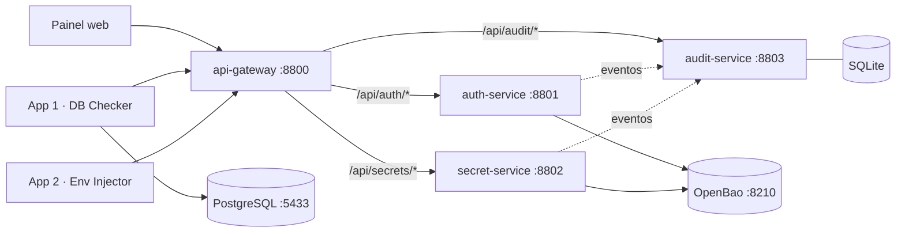

# VaultKit

Framework em Python para conexão simplificada com cofres de segredos, construído com
**componentes de software** e **microserviços**. Cofre usado: **OpenBao 2.7.0** (fork open
source do HashiCorp Vault). Projeto da disciplina *Reuso de Software e Metodologias Ágeis*
(metodologia: Extreme Programming).

A aplicação guarda apenas **onde** a credencial está no cofre (`apps/db-checker/postgres#password`),
nunca o valor. O framework faz login (AppRole), cache, leitura no KV v2, auditoria,
mascaramento de logs e revogação do token.

## Arquitetura



| Camada | Onde | O que é |
| --- | --- | --- |
| Framework | `vaultkit/framework.py` | `SecretAccessFramework`: Template Method (`execute`) + hotspots |
| Componentes | `vaultkit/components/{auth,secrets,cache,audit}` | interface provida + interfaces requeridas, usados pelo framework e pelos serviços |
| Providers | `vaultkit/providers/` | Strategy (`SecretProvider`), Adapters (`VaultProvider`, `OpenBaoProvider`, `GatewayProvider`), Factory/Registry |
| Microserviços | `services/` | FastAPI: gateway, auth, secret, audit |
| Aplicações | `apps/` | `db_checker`, `env_injector`, `exemplo_minimo.py` |

Diagramas UML (Mermaid + PNG) em [`docs/diagramas/`](docs/diagramas).

## Como executar

Pré-requisitos: Docker, Python 3.10+ e um OpenBao em `http://127.0.0.1:8210` com token root
`root-dev` (o do OrbStack, ou `docker compose --profile bao up -d openbao`).

```bash
uv venv && uv pip install -e '.[services,apps,dev]'   # ou: pip install -e '.[services,apps,dev]'
docker compose up -d --build                          # microserviços + PostgreSQL
python -m scripts.provision                           # namespace, policies, AppRoles, segredos
```

As credenciais AppRole de cada aplicação ficam em `.lab/<papel>.env` (fora do Git).

| O quê | Comando |
| --- | --- |
| Painel web | abrir http://127.0.0.1:8800 e entrar com `.lab/dashboard.env` |
| Aplicação 1 | `python -m apps.db_checker.main` (ou `--direct`, `--verbose`) |
| Aplicação 2 | `python -m apps.env_injector.main -- python apps/env_injector/demo_service.py` |
| Exemplo mínimo | `python -m apps.exemplo_minimo` |
| Testes | `pytest` |
| Carga | `locust -f load/locustfile.py --headless -u 20 -r 5 -t 30s --host http://127.0.0.1:8800` |
| Rotacionar senha do banco | `python -m scripts.provision rotate` |
| Swagger de cada serviço | http://127.0.0.1:8800/docs · :8801/docs · :8802/docs · :8803/docs |

O OpenBao em modo dev guarda tudo em memória: depois de reiniciar o container, rode
`python -m scripts.provision` de novo.

## Criando uma nova aplicação

```python
from vaultkit import Secret, SecretAccessFramework, SecretRef, VaultConfig

class PaymentJob(SecretAccessFramework[str, str]):
    app_name = "payment-job"

    def load_references(self):                 # hotspot 1: quais segredos
        return {"token": "apps/env-injector/payments#GATEWAY_TOKEN"}

    def transform(self, alias, ref, secret):   # hotspot 2: como converter
        return secret.value(ref.key)

    def consume(self, items):                  # hotspot 3: o que fazer
        return f"token com {len(items['token'])} caracteres"

config = VaultConfig.from_env()
PaymentJob(config).execute()                                          # direto no OpenBao
PaymentJob(config.with_overrides(provider="gateway")).execute()       # via microserviços
```

Passo a passo completo em [`apps/exemplo_minimo.py`](apps/exemplo_minimo.py).

## Regras de segurança

- a senha nunca é gravada: a aplicação guarda só a referência;
- nenhum token, `secret_id` ou valor de segredo aparece em log, auditoria ou exceção;
- `http://` só com `VAULTKIT_ALLOW_HTTP=true` (laboratório);
- o secret-service usa o token do cliente: a policy do OpenBao decide o que pode ser lido.
